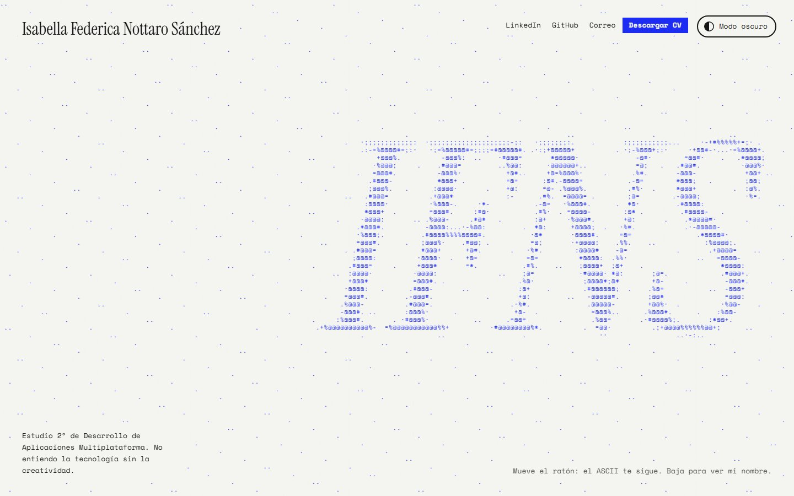
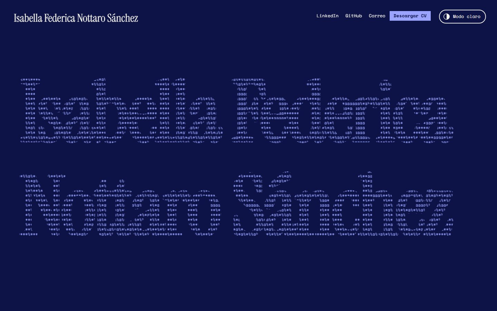
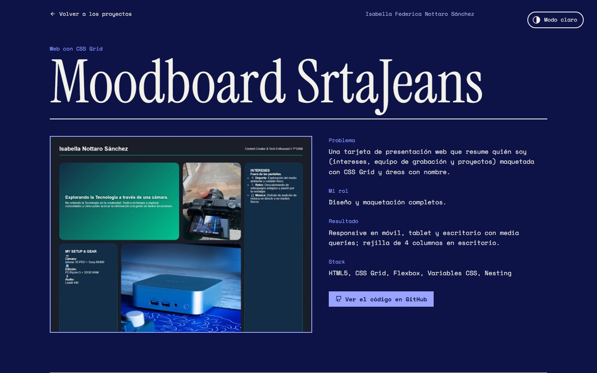
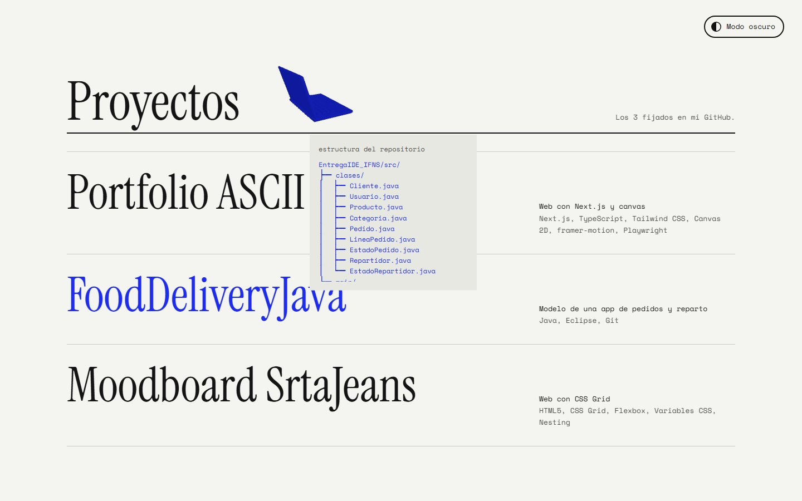
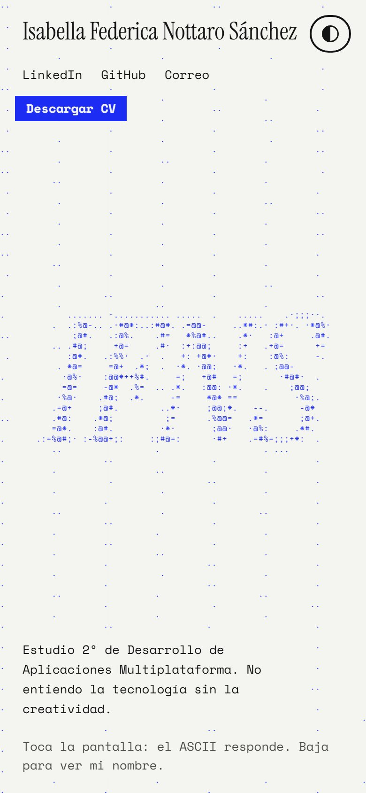
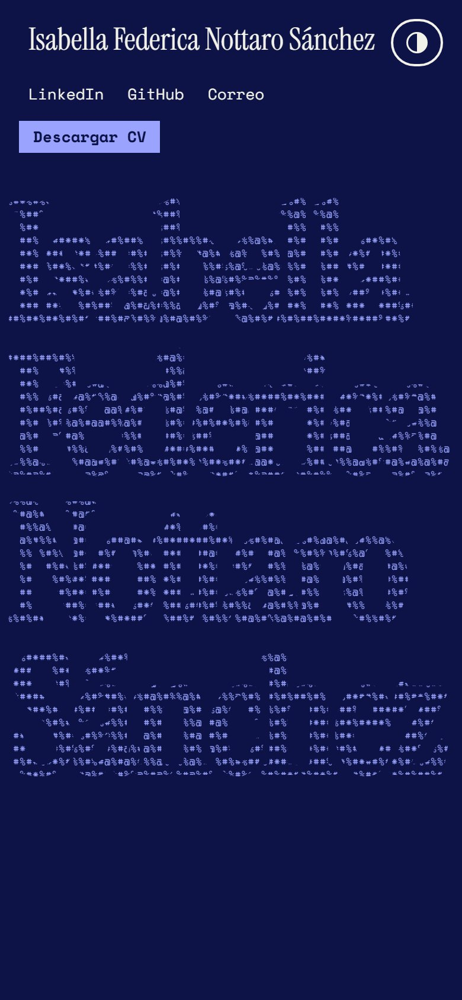

<div align="center">

# Isabella Federica Nottaro Sánchez

**Portfolio web** · estudiante de 2º de Desarrollo de Aplicaciones Multiplataforma

*"No entiendo la tecnología sin la creatividad."*

### [Ver la web: isabellanottaro.vercel.app](https://isabellanottaro.vercel.app)

[LinkedIn](https://www.linkedin.com/in/isabellanottarosanchez/) · [GitHub](https://github.com/nottaroisa) · [Correo](mailto:isabellanottaro@gmail.com) · [TikTok](https://www.tiktok.com/@SrtaJeans) · [Blog](https://blogisabellanottaro.blog)

</div>



## Sobre mí

Soy Isabella. Estudio 2º de **Desarrollo de Aplicaciones Multiplataforma** en CPR Liceo La Paz (2025–2027), después del Bachillerato de Ciencias Sociales en el IES Eusebio da Guarda (2023–2025), y me oriento al desarrollo **full stack**, con base en Java, MySQL, HTML y CSS. Busco prácticas (FCT) de backend o full stack.

Desde 2020 hago **contenido tecnológico en castellano** en TikTok ([@SrtaJeans](https://www.tiktok.com/@SrtaJeans)) y he colaborado con marcas como Xiaomi, Huawei, Telefónica, PcComponentes, AliExpress, Temu, Lewitt y Eneryeti. Explicar tecnología me ha enseñado a organizarme con autonomía, a cuidar cada entrega y a contar las cosas de forma que se entiendan.

Participo en la comunidad de **WordPress** (WordCamp, meetups, traducciones y contribuciones) y en charlas de **GPUL**, y tengo las certificaciones *WordPress Credits*, *Generative AI Foundations* (Pearson) y *Transformación Digital en las Industrias Culturales y Creativas* (Fundación INCYDE).

## El proyecto

Mi portfolio no es una plantilla: está hecho de **caracteres**. La portada es un campo ASCII dibujado en un canvas que forma mis iniciales (IFNS) y se reordena al pasar el ratón: donde lo mueves, los caracteres se convierten en símbolos de código y dejan una estela. Al hacer scroll, el papel cubre el campo y los caracteres siguen vivos solo **dentro de las letras de mi nombre**.

Todo está impreso a **dos tintas**, cobalto y negro sobre papel. En **modo oscuro** la web se convierte en una cianotipia, el negativo de esa impresión: fondo azul de Prusia y tinta de papel.

| Mi nombre escrito con el campo ASCII (modo oscuro) | Página de un proyecto (modo oscuro) |
|---|---|
|  |  |



### Qué tiene

- **Campo ASCII propio** en canvas 2D: convierte una imagen en caracteres según su densidad, solo redibuja las celdas que cambian y se detiene cuando no hay movimiento.
- **Máscara del nombre** ligada al scroll, con framer-motion.
- **Objetos 3D teñidos de azul** junto al título de Proyectos (un portátil), Experiencia (monitor y teclado), Estudios (un birrete), Certificaciones (un libro) y Creo contenido (unos auriculares). three.js los sombrea con la tinta del tema, como una capa de fusión «Color»: sombras en un azul hondo y luces en el azul de la web, también al cambiar de tema. Giran despacio, más deprisa con el ratón encima, y three.js, los modelos y su descompresor solo se descargan al llegar a la sección. En el móvil no se muestran.
- **Proyectos con vista previa** que sigue al cursor, hecha con material real de cada uno: la estructura de ficheros del repositorio o una captura de la web desplegada. Son los repositorios fijados en mi perfil de GitHub.
- **Una página por proyecto** (`/proyectos/<id>`), generada al compilar, con el problema, mi rol, el resultado y el enlace al código.
- **Creo contenido**: resumen de mi cuenta de TikTok con cifras que se "calculan" al verse, y cuatro vídeos con un botón de play dibujado en ASCII y una miniatura de su portada junto a su descripción. El reproductor de TikTok solo se carga al pulsarlos (sin scripts ni cookies de TikTok hasta entonces).
- **Créditos**: las marcas con las que he trabajado, como los créditos del final de un vídeo, cada una con sus vídeos y su web.
- **Estudios y certificaciones**, con enlace a la credencial cuando la tiene. Los enlaces a certificados, credenciales, GitHub y «Volver» llevan su icono animado.
- **Comunidades** como credenciales de evento que cuelgan de su cinta: WordPress Coruña (con mi blog) y GPUL.
- **Créditos y licencias** (`/creditos`, enlazada desde el pie): de dónde sale cada cosa que no he hecho yo, quién la hizo, con qué licencia se usa y qué he cambiado.
- **Contacto** con estado de disponibilidad, el correo que se copia al pulsarlo y un botón «Escríbeme un correo» que lo abre con asunto y saludo ya puestos (también desde Gmail). Los botones llevan iconos animados: el sobre se abre, la flecha baja al CV y, al copiar el correo, se dibuja la marca de copiado.
- **Modo claro y oscuro** con un botón fijo arriba a la derecha. Entra en modo oscuro y recuerda la elección; la barra del navegador del móvil acompaña al tema.
- **Responsive**: en el móvil el campo responde al tocar y el nombre se recompone en cuatro líneas; sin ratón (móvil o tablet), las vistas previas de los proyectos van debajo de cada uno.

<p align="center">
  
  &nbsp;&nbsp;
  
</p>

### Accesibilidad y rendimiento

- **Lighthouse** (medición de la primera versión, octubre de 2026): 100 en accesibilidad, buenas prácticas y SEO, y 99–100 en rendimiento, en móvil y escritorio.
- **Contraste WCAG AA** comprobado texto a texto en los dos temas. Texto principal a más de 15:1.
- Respeta **`prefers-reduced-motion`**: sin animación de entrada, sin estela y sin escalado.
- El canvas es decorativo (`aria-hidden`): el nombre, los textos y todos los enlaces están en el HTML y se pueden recorrer con el teclado.

## Tecnologías

| | |
|---|---|
| Framework | [Next.js 16](https://nextjs.org) (App Router) con exportación estática |
| Estilos | [Tailwind CSS 4](https://tailwindcss.com) |
| Animación | [framer-motion](https://motion.dev), cargado en modo ligero (`LazyMotion`) |
| Gráficos | Canvas 2D propio (campo ASCII) y [three.js](https://threejs.org) para los objetos 3D |
| Tipografía | [Instrument Serif](https://fonts.google.com/specimen/Instrument+Serif) y [Space Mono](https://fonts.google.com/specimen/Space+Mono) |
| Lenguaje | TypeScript |

## Estructura

```
app/
  page.tsx                  portada
  creditos/page.tsx         créditos y licencias
  proyectos/[id]/page.tsx   una página por proyecto
  globals.css               tintas del modo claro y oscuro
components/
  ascii/CampoAscii.tsx      motor del campo ASCII
  ascii/Modelo3D.tsx        objeto 3D que carga three.js al llegar a la vista
  ascii/motor3d.ts          three.js: pinta el modelo teñido con la tinta azul
  IconosAnimados.tsx        iconos animados de los botones
  Hero.tsx                  portada con la máscara del nombre
  ListaProyectos.tsx        lista con vista previa flotante
  CreoContenido.tsx         TikTok: resumen y vídeos
  VideoTikTok.tsx           vídeo con play en ASCII que carga TikTok solo al pulsarlo
  Creditos.tsx              marcas con sus vídeos y su web
  Comunidades.tsx           comunidades como credenciales de evento
  Contacto.tsx              estado, redes y botones de contacto
  CopiarCorreo.tsx          correo que se copia al pulsarlo
  BotonTema.tsx             botón de modo claro/oscuro
lib/
  data.ts                   todo el contenido: proyectos, experiencia, estudios, certificaciones, vídeos y enlaces
  creditos.ts               de dónde sale cada cosa y con qué licencia
  correo.ts                 correo preparado (asunto y saludo) para mailto y Gmail
  tema.ts                   lógica del tema
public/
  cv-isabella-nottaro.pdf   CV descargable
  contenido/                portadas de los vídeos de TikTok
  modelos/                  modelos 3D (GLB con Draco) de threejsassets
  draco/                    descompresor de Draco para los modelos
e2e/                        tests de aceptación con Playwright, uno por funcionalidad
```

## Ejecutar en local

```bash
npm install
npm run dev
```

Se abre en http://localhost:3000.

Para generar la web estática:

```bash
npm run build
npx serve out
```

`npm run build` crea la carpeta `out/` con la web completa, lista para cualquier hosting estático.

## Pruebas

Tests de aceptación con [Playwright](https://playwright.dev), en `e2e/`. La primera vez hay que descargar el navegador:

```bash
npx playwright install chromium
```

Contra la web en local (arranca `npm run dev` si no está en marcha):

```bash
npm test
```

Son 47 tests, uno por cada cosa que la web promete: el modo oscuro, el contacto, los proyectos, el contenido, las comunidades, los estudios, los iconos, los objetos 3D, los créditos, el móvil y la tablet. La primera vez que se lanzan contra `npm run dev`, Next.js compila las páginas mientras llegan las peticiones y algún test puede pasarse de tiempo; al repetirlos, pasan.

Contra otra dirección, por ejemplo la publicada (en PowerShell: `$env:BASE_URL="https://isabellanottaro.vercel.app"; npm test`):

```bash
BASE_URL=https://isabellanottaro.vercel.app npm test
```

## Desplegar

La web está publicada en Vercel: **[isabellanottaro.vercel.app](https://isabellanottaro.vercel.app)**. Cada `git push` a la rama `main` la actualiza sola.

Para desplegarla en otro sitio: en Vercel se importa el repositorio y detecta Next.js sin configuración; en cualquier otro hosting estático basta con subir el contenido de `out/`.

## Créditos

La lista completa, con lo que es mío y lo que es de terceros, está en la página [Créditos y licencias](https://isabellanottaro.vercel.app/creditos).


- Las ideas de la máscara de texto, la vista previa que sigue al cursor y el texto que se descifra parten de componentes de [ui-layouts](https://github.com/ui-layouts/ui-layouts) (licencia MIT), adaptados y reescritos para este proyecto.
- Los iconos animados (contacto, páginas de proyecto y certificados) son de [animateicons](https://github.com/Avijit07x/animateicons) (licencia MIT, formas de [Lucide](https://lucide.dev)), adaptados al `LazyMotion` de la web.
- El birrete es [«Graduation Hat»](https://sketchfab.com/3d-models/graduation-hat-b0a7e821403b4c8cb8e1d32ea4075eac) de [DevFaisal](https://sketchfab.com/DevFaisal), con licencia [CC BY 4.0](https://creativecommons.org/licenses/by/4.0/); lo he simplificado y comprimido.
- El resto de modelos 3D son de la colección gratuita de [threejsassets](https://threejsassets.com/assets/free) ([Free Commercial License](https://threejsassets.com/license), sin atribución obligatoria); el descompresor de Draco viene con three.js (licencia Apache 2.0).
- Fuentes de [Google Fonts](https://fonts.google.com) bajo licencia SIL Open Font License.

---

<div align="center">

Octubre de 2026 · hecho por Isabella Federica Nottaro Sánchez

</div>
